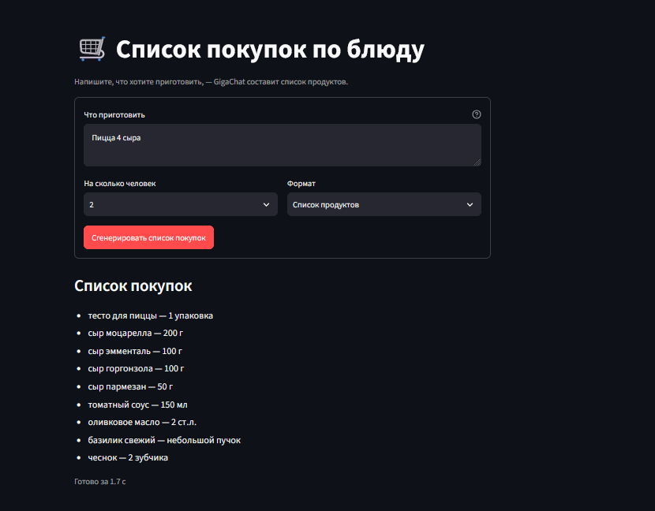
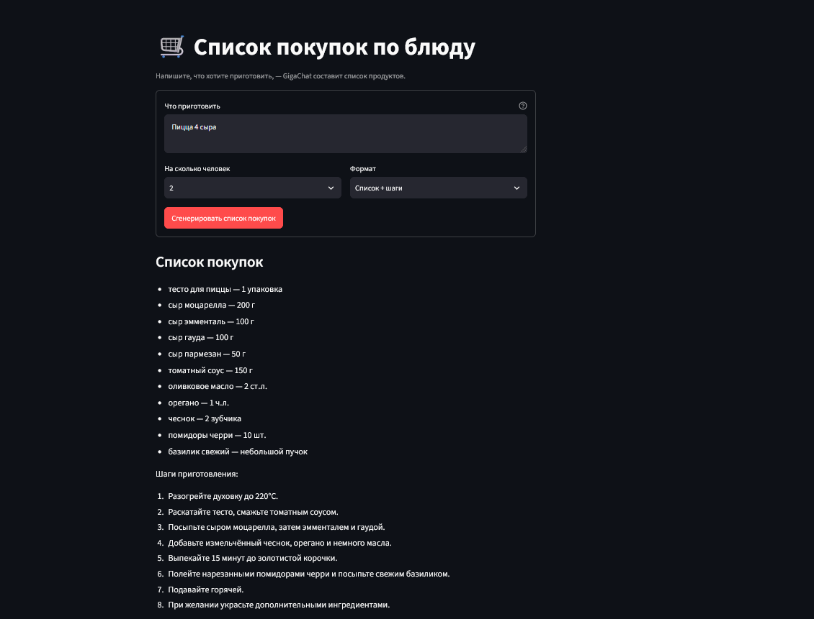
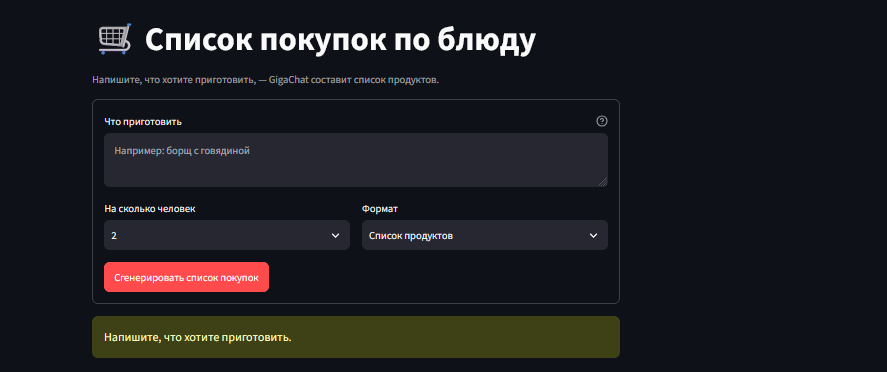
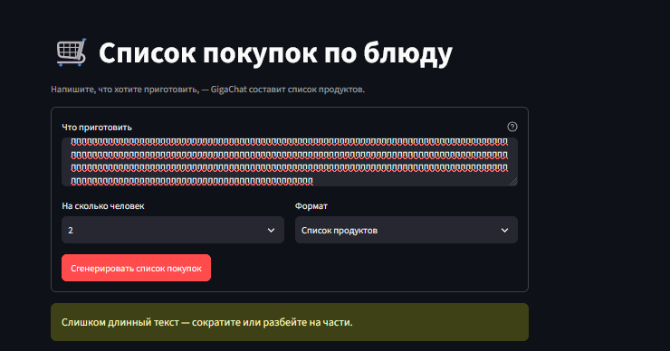
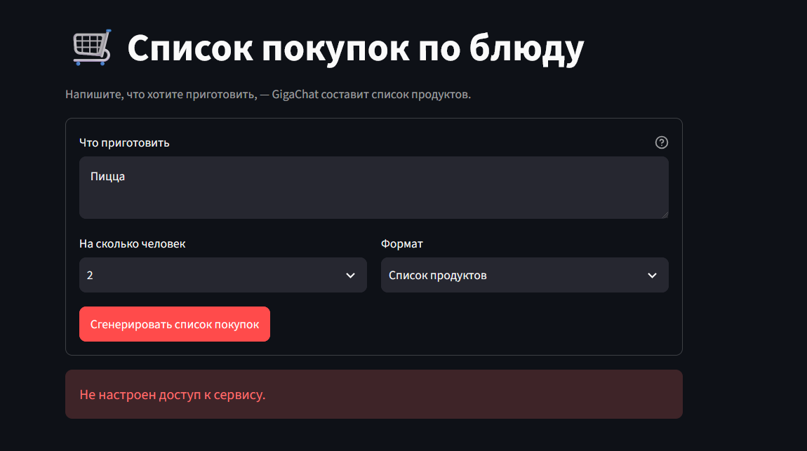

# 🛒 Список покупок по блюду — Streamlit + GigaChat API

Минимальный интерфейс по схеме **ввод → обработчик → вывод**: пользователь пишет блюдо, выбирает число людей и формат,
GigaChat возвращает список покупок (и, по желанию, шаги приготовления).

- Ввод проверяется **до** вызова API: пустой и слишком длинный текст в модель не уходят.
- Ошибки API показываются **одним предложением**, без traceback и без утечки секретов.
- Ключ берётся только из переменных окружения (`.env`), в логи пишутся длины и коды, а не ключи и тексты.

## Структура

| Файл | Назначение |
|---|---|
| `streamlit_app.py` | интерфейс: поле блюда, два выпадающих списка, кнопка, вывод результата |
| `llm.py` | обработчик: проверка ввода, промпт, токен GigaChat, вызов модели, карта ошибок, логи |
| `scripts/check_access.py` | проверка доступа без интерфейса: получает токен и показывает доступные модели |
| `scripts/fake_gigachat.py` | фейковый GigaChat для воспроизведения ошибок без ключа |
| `tests/` | 23 автотеста обработчика (pytest) |
| `certs/` | сюда кладётся сертификат НУЦ Минцифры |

Как работает обработчик:

```
generate(dish, people, format)
  ├─ validate()          пустой / длиннее 300 символов / неизвестная опция → сообщение, API не вызывается
  ├─ build_messages()    системная инструкция + блюдо, число людей и формат — явно
  ├─ _get_token()        OAuth: ключ авторизации → access token (живёт 30 мин, кешируется)
  ├─ _chat_with_retry()  POST /chat/completions, таймаут; 5xx / таймаут / сеть → 1 повтор через 1 с
  └─ Result(ok, text)    ответ модели или одно предложение об ошибке
```

## Запуск

Нужен Python 3.10+. Команды для Windows (PowerShell); для macOS/Linux — в комментариях.

### 1. Окружение

```powershell
cd shopping_list_app
python -m venv venv
venv\Scripts\Activate.ps1            # macOS/Linux: source venv/bin/activate
pip install -r requirements.txt
```

### 2. Ключ GigaChat

1. Войдите в личный кабинет на [developers.sber.ru](https://developers.sber.ru/studio) и создайте проект **GigaChat API** (для физлиц есть бесплатный лимит токенов).
2. В настройках API сгенерируйте **ключ авторизации** (Authorization key) и скопируйте его.

### 3. Сертификат НУЦ Минцифры

Сертификаты серверов GigaChat выпущены российским удостоверяющим центром, которого нет в стандартном наборе Python.
Скачайте корневой сертификат **Russian Trusted Root CA** на [gosuslugi.ru/crt](https://www.gosuslugi.ru/crt)
и положите его в папку `certs/` как `russian_trusted_root_ca.cer`. Подходит и PEM, и DER.

> Проверка TLS в приложении не отключается — вместо этого к стандартному набору сертификатов добавляется этот.

### 4. Файл `.env`

```powershell
copy .env.example .env               # macOS/Linux: cp .env.example .env
notepad .env
```

```dotenv
GIGACHAT_CREDENTIALS=<ваш ключ авторизации>
GIGACHAT_SCOPE=GIGACHAT_API_PERS
GIGACHAT_MODEL=GigaChat-2
GIGACHAT_CA_BUNDLE=certs/russian_trusted_root_ca.cer
GIGACHAT_TIMEOUT=30
```

### 5. Проверка доступа (необязательно, но экономит время)

```powershell
python scripts/check_access.py
```

Ожидается `✅ Токен получен.` и список доступных моделей (например, `GigaChat-2`, `GigaChat-2-Pro`, `GigaChat-2-Max`, `GigaChat-3-*`). Для списка покупок достаточно лёгкой `GigaChat-2` — она быстрее и меньше расходует бесплатный лимит. Если её нет в списке — впишите в `GIGACHAT_MODEL` одну из доступных.

### 6. Запуск интерфейса

```powershell
streamlit run streamlit_app.py
```

Откроется браузер на `http://localhost:8501`.

## Тест-сценарии

| # | Ввод | Ожидаемый результат | Вызов API |
|---|---|---|---|
| 1 | «Борщ с говядиной», 4 человека, «Список продуктов» | список: по строке на продукт, количества на 4 человек | да |
| 1a | то же, формат «Список + шаги» | список + «Шаги приготовления:» из 5–8 пунктов | да |
| 2 | пустое поле или только пробелы | предупреждение «Напишите, что хотите приготовить.» | **нет** |
| 3 | текст длиннее 300 символов | предупреждение «Слишком длинный текст — сократите или разбейте на части.» | **нет** |

После сценариев 2 и 3 прошлый успешный результат остаётся на экране с подписью «Предыдущий результат».
То, что API не вызывался, видно в `logs/app.log`: есть событие `validation_failed`, а `llm_ok` / `http_error` нет.

## Демонстрация (GigaChat-2)

| # | Сценарий | Результат |
|---|---|---|
| 1 | «Пицца 4 сыра», 2 человека, «Список продуктов» | список «продукт — количество», 9 позиций, ответ за 1,7 с |
| 1a | то же, «Список + шаги» | список + 8 шагов приготовления |
| 2 | пустое поле | «Напишите, что хотите приготовить.» — API не вызывался |
| 3 | текст длиннее 300 символов | «Слишком длинный текст — сократите или разбейте на части.» — API не вызывался |
| 4 | ключ убран из `.env` | «Не настроен доступ к сервису.» — без traceback |

**1. Нормальный ввод — список продуктов**



**1a. Формат «Список + шаги»**



**2. Пустой ввод**



**3. Слишком длинный ввод**



**4. Ошибка API: не задан ключ**



## Как воспроизвести ошибки API

**Самое простое — убрать ключ.** В `.env` закомментируйте строку `GIGACHAT_CREDENTIALS`, перезапустите Streamlit
и нажмите кнопку → «Не настроен доступ к сервису.»

Остальные ошибки:

| Ошибка | Как воспроизвести | Что увидит пользователь |
|---|---|---|
| Нет ключа | убрать `GIGACHAT_CREDENTIALS` | Не настроен доступ к сервису. |
| Неверный ключ (401) | вписать в ключ любую строку | Не настроен доступ к сервису. |
| Нет сертификата | указать в `GIGACHAT_CA_BUNDLE` несуществующий файл | Не настроен доступ к сервису. |
| Нет сети | отключить интернет | Не удалось получить ответ. Попробуйте ещё раз. |

**Через фейковый сервер** — без отключения интернета и без настоящего ключа:

```powershell
python scripts/fake_gigachat.py error500      # отдельный терминал; режимы: ok, unauthorized, error500, slow, empty, badjson
```

В `.env` раскомментируйте `GIGACHAT_AUTH_URL` и `GIGACHAT_BASE_URL` (адреса `127.0.0.1:8002`), задайте `GIGACHAT_CREDENTIALS=fake`
и перезапустите Streamlit. Режим меняется перезапуском фейкового сервера с другим аргументом.

| Режим | Ошибка | Сообщение | Повтор |
|---|---|---|---|
| `unauthorized` | 401 при получении токена | Не настроен доступ к сервису. | нет |
| `error500` | 500 от модели | Сервис временно недоступен. Попробуйте позже. | 1 повтор |
| `slow` | таймаут (поставьте `GIGACHAT_TIMEOUT=3`) | Не удалось получить ответ. Попробуйте ещё раз. | 1 повтор |
| `empty` | пустой ответ модели | Пустой ответ модели. Попробуйте переформулировать вопрос. | нет |
| `badjson` | ответ не JSON | Пустой ответ модели. Попробуйте переформулировать вопрос. | нет |

## Карта ошибок

| Ситуация | Сообщение | Повтор |
|---|---|---|
| 4xx: нет или неверный ключ, нет прав, проблема с сертификатом | Не настроен доступ к сервису. | нет |
| 429: лимит запросов | Слишком много запросов. Подождите немного и попробуйте снова. | нет |
| 5xx: сервис недоступен | Сервис временно недоступен. Попробуйте позже. | 1, через 1 с |
| Таймаут, обрыв сети | Не удалось получить ответ. Попробуйте ещё раз. | 1, через 1 с |
| Пустой или битый ответ | Пустой ответ модели. Попробуйте переформулировать вопрос. | нет |
| Любая непредвиденная ошибка | Что-то пошло не так. Попробуйте ещё раз. | нет (подробности в лог) |

Если access token истёк между запросами (401 от модели), обработчик один раз получает новый токен и повторяет запрос.

## Автотесты

```powershell
pip install -r requirements-dev.txt
python -m pytest -q          # 23 passed — настоящий GigaChat не вызывается
```

Тесты поднимают фейковый сервер и проверяют все ветки: три сценария ввода, отсутствие вызова API при ошибке ввода,
401 без повторов, 500 и таймаут с одним повтором, пустой и битый ответ, кеш токена, сертификат в PEM и DER,
отсутствие ключей и текста пользователя в логах.

## Логи

`logs/app.log` — по одной строке на событие, только «скелет»: тип события, длина ввода и ответа, модель, код ошибки, время.

```
2026-11-04 13:40:01 INFO {"event": "token_refreshed"}
2026-11-04 13:40:04 INFO {"event": "llm_ok", "model": "GigaChat-2", "people": "4", "format": "Список продуктов", "dish_chars": 16, "answer_chars": 214, "duration_s": 2.8}
2026-11-04 13:40:10 INFO {"event": "validation_failed", "reason": "Напишите, что хотите приготовить.", "dish_chars": 3}
2026-11-04 13:41:02 WARNING {"event": "http_error", "stage": "chat", "status": 500}
2026-11-04 13:41:02 WARNING {"event": "retry", "error": "ServerError", "pause_s": 1.0}
```

Ключ авторизации, access token и текст запроса в лог не попадают (это проверяется автотестом).
